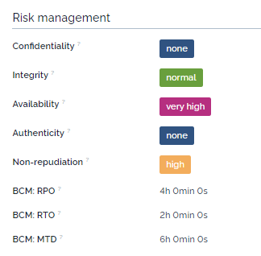

# Risk Assessment for iTop

Record what a business process or application needs to protect, how much data it
can afford to lose, and how quickly it must recover. Keep those requirements on
the configuration items (CIs) your team already manages in iTop.

If your payroll application needs **high** availability and its linked server is
rated **normal**, the built-in audit flags the server for review. You can see
where the documented requirements diverge before planning a recovery exercise.

## Choose a version

| Your iTop version | Extension version                                             |
| ----------------- | ------------------------------------------------------------- |
| 3.3.0 or later    | Risk Assessment releases starting with 3.3.0                  |
| 3.2.x             | A 3.2.x release or the [itop/3.2 maintenance branch][itop-32] |
| 2.7 or 3.1        | The [itop/2.7 branch][itop-27]                                |

Previous versions of the extension were tested on iTop 2.7.10 and 3.2.1.

## Install and record your first assessment

1. Download the `br-riskassessment-vX.Y.Z.zip` asset for your iTop version from
   [GitHub Releases][releases].
2. Extract it into your iTop installation’s `extensions/` directory. The package
   places its manifest at `extensions/br-riskassessment/extension.xml`.
3. Run iTop Setup and select **Datamodel: Risk Assessment**. The extension
   requires iTop Configuration Management, Enhanced Customer Portal and the standard
   ITIL profiles, each at version 3.3.0 or later.
4. In the iTop console, open an application solution or business process, choose
   **Edit**, and fill in the **Risk management** section. Save the record.

Servers and network devices have the same section. Installing the virtualization
module also makes it available on virtual machines. On all five object types you can
also search by any of the five protection fields.

## What to record

| Protection field                         | Available levels              |
| ---------------------------------------- | ----------------------------- |
| Confidentiality, integrity, availability | None, normal, high, very high |
| Authenticity, non-repudiation            | None, high                    |

Use the three recovery objectives to document your business continuity plan.
For example, a payroll team might agree on the following targets.

| Recovery objective               | Question it answers                                 | Example    |
| -------------------------------- | --------------------------------------------------- | ---------- |
| Recovery Point Objective (RPO)   | How much recent data can we lose, measured in time? | 15 minutes |
| Recovery Time Objective (RTO)    | How soon should service be restored?                | 4 hours    |
| Maximum Tolerable Downtime (MTD) | How long can the business tolerate an outage?       | 8 hours    |

When you enter a positive RTO, enter an MTD at least as long. iTop checks this
when either value changes. In the example above, an MTD of three hours would
prevent saving because it is shorter than the four-hour recovery target.

## Find gaps between applications and infrastructure

When iTop audit management is available, setup installs five rules in the
**Risk Management Mismatch** category, one per protection field. They compare
an application solution with its directly linked servers, farms, hypervisors,
and virtual machines. A rule flags the linked CI when its protection level is
lower than the application requires or the required rating is missing.

To try the payroll example, link the server to the application solution, save
the two availability ratings, and run the **Risk Management** audit. The server
appears under the availability rule.

## Share assessments

The **Risk Manager** and **Risk Agent** profiles grant write access to
application solutions and business processes. Risk Managers can also update
these objects in bulk.

The portal provides read-only assessment views for application solutions and
business processes. If you select System Landscape (br-landscape 3.2.2 or later)
alongside Risk Assessment, iTop Setup automatically selects the bundled bridge.
The application solution form then shows **System landscape** as a read-only field.

Contacts can view objects they are linked to. Portal power
users can also view objects belonging to their organization.

## Languages and project information

The extension includes English, German, and Russian translations. Thanks to
[Konstantin Nikulin][translator] for the Russian translation.

- [Run the local tests and XML schema checks](tests/README.md)
- [Prepare and publish a release](scripts/README.md)
- [GPL-3.0 license](LICENSE) · Copyright © 2021–2026 Björn Rudner

[releases]: https://github.com/rudnerbjoern/iTop-br-riskassessment/releases
[itop-32]: https://github.com/rudnerbjoern/iTop-br-riskassessment/tree/itop/3.2
[itop-27]: https://github.com/rudnerbjoern/iTop-br-riskassessment/tree/itop/2.7
[translator]: https://github.com/apollo2k4
